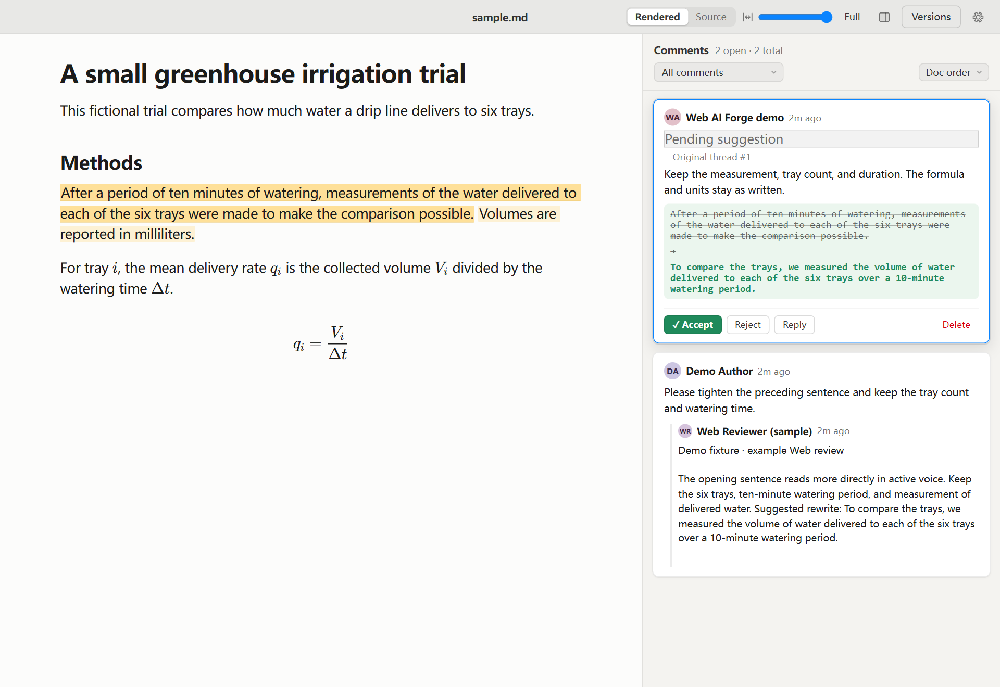

# Web AI Forge

**Use ChatGPT Web when CLI polishing falls short.**

When CLI-only edits miss your intended tone or leave the writing awkward, polish selected passages in ChatGPT Web. Web AI Forge brings the original AI feedback and suggested edits back into Markdown, where you can compare versions and approve each change. You can import feedback from other AI assistants the same way.

## See the demo

In this fictional greenhouse trial, a wordy methods sentence becomes a direct explanation of what was measured. The review pane shows the author's comment, a sample Web reviewer reply, and the proposed edit with **Accept** and **Reject**.



**Before** — After a period of ten minutes of watering, measurements of the water delivered to each of the six trays were made to make the comparison possible.

**Suggested** — To compare the trays, we measured the volume of water delivered to each of the six trays over a 10-minute watering period.

The screenshot comes from the running review interface and uses a labeled example reply. [Follow the demo](demo/README.md) · [Open the sample Markdown](demo/sample.md)

## A + B + C

| Component | Role |
| --- | --- |
| **A · Forgemark** | Markdown reading and editing, anchored review threads, and visual suggestions. Built by [sskaye and the Forgemark contributors](https://github.com/sskaye/forgemark). |
| **B · MCP-CodexGPT** | Provided the ChatGPT Web bridge for the local prototype. Built by [MosMotov and the MCP-CodexGPT contributors](https://github.com/MosMotov/MCP-CodexGPT). |
| **C · Web AI Forge integration** | Brings the browser review workspace, batched handoff to Codex, original AI feedback, and human approval into a single workflow. |

## Install with an AI agent

Open [INSTALL_WITH_AI.md](INSTALL_WITH_AI.md) and send the entire Markdown file to your coding agent, along with the repository URL or local checkout path. The agent follows the repository's documented setup and opens the synthetic demo for verification.

With Git and Node.js 22.12 or later available, the same local setup can be run from the checkout:

```text
npm run setup
npm run demo
```

Open the loopback URL printed by the start command. `npm run demo -- --port 1431` selects a different port if the default is already in use. Use `npm test` to check the synthetic review fixture after setup.

To open your own Markdown file, run `npm start -- --document path/to/draft.md`. The server opens only the selected file and listens on loopback.

## How the workflow works

1. Read the full Markdown document and annotate the relevant passage or LaTeX expression.
2. Collect comments for a single handoff to your coding agent.
3. Share selected excerpts with your chosen AI reviewer and add its reply to the review thread.
4. Read the original AI feedback alongside Codex's checked revision in the relevant thread.
5. Accept, reject, or discuss each proposed change. Review history records the decision.

The first version imports feedback you copy from the reviewer. This lets you use ChatGPT Web when the CLI pass falls short and bring the exact response back into the review thread.

- `node src/review-batch.mjs path/to/draft.md` prints open comments for a single handoff to your coding agent.
- `node src/review-import.mjs path/to/draft.md THREAD_ID reply.txt replacement.txt anchor.txt` adds the saved reviewer reply to the selected thread and stages the replacement against the exact original text in `anchor.txt`. Pass only `reply.txt` after the thread ID to import the reply alone. The suggestion stays pending in the review pane.

Use an exact replacement span clear of existing inline comment anchors. In the demo, the author comments on the sentence next to the one being rewritten, and the proposed rewrite links back to that thread.

## Release status

This initial source release uses a pinned Forgemark checkout and a local browser host. The example is a fictional draft with a preloaded review thread. See [the walkthrough](demo/README.md) to reproduce it from the clean sample.

## Credits and licensing

The source projects and their copyright notices are listed in [THIRD_PARTY_NOTICES.md](THIRD_PARTY_NOTICES.md). Thanks to Mustafa Akben and the [MD Review](https://github.com/mustafaakben/md-review) project for an earlier workflow prototype.
