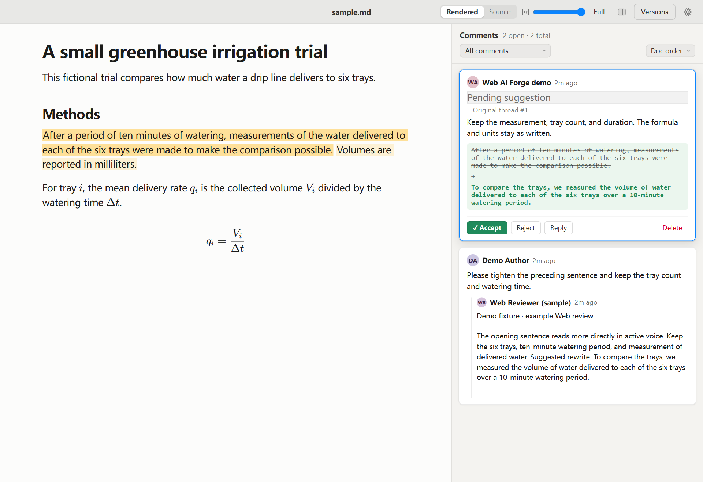

# Try Web AI Forge on a fictional draft

Start with [sample.md](sample.md), a fictional greenhouse irrigation trial. The draft has an awkward methods sentence and a Markdown equation. The goal is to make the sentence clearer while preserving the six trays, the ten-minute watering period, and the equation.

After setup, run `npm run demo` and open the URL printed in the terminal. The demo starts from [a prepared copy](reviewed-sample.md) with one open suggestion. The app stores your working copy under `runtime/` so the included samples stay reusable. To recreate the steps below, copy the clean sample to a new file and open it with `npm start -- --document path/to/your-copy.md`.

## Walk through the review

1. Open a local copy of `sample.md` in Web AI Forge. Select “Volumes are reported in milliliters.” and add a comment asking for a clearer preceding sentence. For example, “Please tighten the preceding sentence and keep the tray count and watering time.”
2. For a live editorial pass, share the two methods sentences in ChatGPT Web and ask for one direct rewrite of the first sentence, with the facts preserved. Copy the reply back into the same review thread and identify ChatGPT Web as its source. For a reproducible walkthrough, use the demonstration feedback below.
3. Ask your coding agent to stage the replacement on the first methods sentence and link it to that thread. Compare the original and proposed wording in the review pane.
4. Accept the suggestion to apply the revised sentence, or reject it to keep the original. The reporting units and the equation stay in place in either case.

Example instruction for the coding agent:

> Use the local copy of the greenhouse demo and find my comment about the first Methods sentence. Add the reviewer reply I provide to that thread with its source. Stage the proposed replacement on the first Methods sentence and leave it pending for me to review.

## Before and after

| Original draft | Suggested rewrite |
| --- | --- |
| After a period of ten minutes of watering, measurements of the water delivered to each of the six trays were made to make the comparison possible. | To compare the trays, we measured the volume of water delivered to each of the six trays over a 10-minute watering period. |

**Demonstration feedback fixture**

> The opening sentence reads more directly in active voice. Keep the six trays, ten-minute watering period, and measurement of delivered water. Suggested rewrite: To compare the trays, we measured the volume of water delivered to each of the six trays over a 10-minute watering period.

The fixture is sample text for the walkthrough. A live pass uses the actual reply you copy from your AI assistant.
